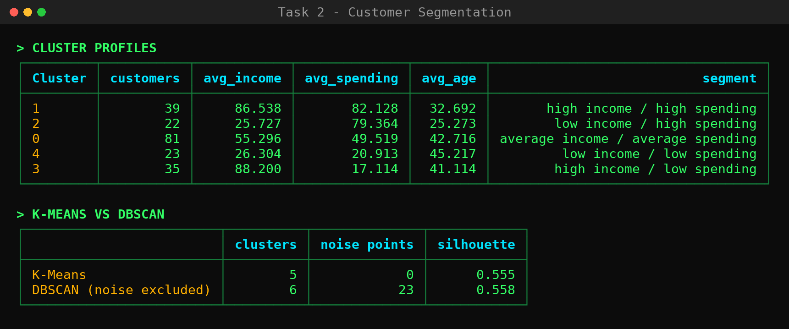

# Task 2 - Customer Segmentation

**Level 1** · Notebook: [`Task2_Customer_Segmentation.ipynb`](Task2_Customer_Segmentation.ipynb)

## Task brief (from the Elevvo task sheet)

**Description**
- Dataset (recommended): Mall Customer (Kaggle)
- Cluster customers into segments based on income and spending score
- Perform scaling and visual exploration of groupings
- Apply K-Means clustering and determine optimal number of clusters
- Visualize clusters using 2D plots

**Tools & libraries:** Python · Pandas · Matplotlib · Scikit-learn

**Covered topics:** Clustering · Unsupervised learning

**Bonus**
- Try different clustering algorithms (e.g., DBSCAN)
- Analyze average spending per cluster

## Requirements checklist

| Requirement | Status | Where |
|-------------|--------|-------|
| Use the Mall Customer dataset (Kaggle) | ✅ | Section 1 (`Mall_Customers.csv`) |
| Cluster customers by income and spending score | ✅ | Sections 3-5 |
| Perform scaling | ✅ | Section 3 (`StandardScaler`) |
| Visual exploration of groupings | ✅ | Section 2 (age / income / spending distributions, income vs spending scatter) |
| Apply K-Means and determine the optimal number of clusters | ✅ | Section 4 (elbow method + silhouette score for k = 2-10) |
| Visualize clusters using 2D plots | ✅ | Section 5 (clusters and centroids on income vs spending) |
| **Bonus:** try a different clustering algorithm (DBSCAN) | ✅ | Section 7 |
| **Bonus:** analyze average spending per cluster | ✅ | Section 6 (profile table and bar chart) |

## Dataset

200 mall customers with gender, age, annual income (k$) and spending score (1-100). No missing values or duplicates. Clustering uses annual income and spending score, both standardized to mean 0 and standard deviation 1.

## Results

**Choosing k:** the silhouette score peaks at **k = 5 (0.555)**, which also matches the bend in the elbow curve.

| k | 2 | 3 | 4 | **5** | 6 | 7 | 8 |
|---|---|---|---|---|---|---|---|
| Silhouette | 0.321 | 0.467 | 0.494 | **0.555** | 0.540 | 0.528 | 0.455 |

**The 5 segments (average spending per cluster):**

| Segment | Customers | Avg income (k$) | Avg spending | Avg age |
|---------|-----------|-----------------|--------------|---------|
| High income / high spending | 39 | 86.5 | 82.1 | 32.7 |
| Low income / high spending | 22 | 25.7 | 79.4 | 25.3 |
| Average income / average spending | 81 | 55.3 | 49.5 | 42.7 |
| Low income / low spending | 23 | 26.3 | 20.9 | 45.2 |
| High income / low spending | 35 | 88.2 | 17.1 | 41.1 |

**K-Means vs DBSCAN:**

| Algorithm | Clusters | Outliers | Silhouette |
|-----------|----------|----------|------------|
| K-Means (k = 5) | 5 | 0 | 0.555 |
| DBSCAN (eps 0.35, min 5) | 6 | 23 | 0.558 (outliers excluded) |

## Conclusion

- **5 clear customer segments** exist, confirmed by both the silhouette score and the elbow method.
- **Income alone doesn't predict spending:** two groups earn the same high income (about $87k), but one spends heavily (82) and the other barely spends (17).
- **Business use:** the *high income / high spending* group is the best target for premium offers, the *high income / low spending* group is the biggest untapped opportunity for marketing, and the young *low income / high spending* group responds to trends and deals.
- **DBSCAN** finds similar groups with a similar silhouette (0.558) but labels 23 customers as outliers. K-Means is more practical here because every customer gets a segment, while DBSCAN is useful for spotting unusual customers.

## How to run

Put `Mall_Customers.csv` next to the notebook and run all cells.
