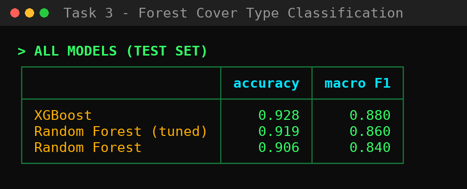

# Task 3 - Forest Cover Type Classification

**Level 2** · Notebook: [`Task3_Forest_Cover_Type.ipynb`](Task3_Forest_Cover_Type.ipynb)

## Task brief (from the Elevvo task sheet)

**Description**
- Dataset (recommended): Covertype (UCI)
- Predict the type of forest cover based on cartographic and environmental features
- Clean and preprocess the data including categorical handling
- Train and evaluate multi-class classification models
- Visualize confusion matrix and feature importance

**Tools & libraries:** Python · Pandas · Scikit-learn · XGBoost

**Covered topics:** Multi-class classification · Tree-based modeling

**Bonus**
- Compare different models (e.g., Random Forest vs. XGBoost)
- Perform hyperparameter tuning

## Requirements checklist

| Requirement | Status | Where |
|-------------|--------|-------|
| Use the Covertype (UCI) dataset | ✅ | Section 1 (`fetch_covtype`) |
| Predict forest cover type from cartographic and environmental features | ✅ | Sections 4-5 |
| Clean and preprocess the data, including categorical handling | ✅ | Sections 1-2 (missing/duplicate check, one-hot check of 4 wilderness + 40 soil columns) |
| Train and evaluate multi-class classification models | ✅ | Section 5 (accuracy, macro F1) |
| Visualize the confusion matrix | ✅ | Section 7 |
| Visualize feature importance | ✅ | Section 8 |
| **Bonus:** compare Random Forest vs. XGBoost | ✅ | Section 5 |
| **Bonus:** hyperparameter tuning | ✅ | Section 6 (`RandomizedSearchCV`) |

## Dataset

581,012 forest patches (30 x 30 m), 54 features (elevation, aspect, slope, distances to water / roads / fire points, hillshade, 4 wilderness areas, 40 soil types), 7 cover types. No missing values or duplicates. The classes are very imbalanced (Lodgepole Pine 48.8%, Spruce/Fir 36.5%, Cottonwood/Willow only 0.5%), so a **stratified 100,000-row sample** keeps every class's share while keeping training fast. Split: stratified 80% train / 20% test.

## Results

| Model | Accuracy | Macro F1 |
|-------|----------|----------|
| **XGBoost** | **0.928** | **0.880** |
| Random Forest (tuned) | 0.919 | 0.860 |
| Random Forest (default) | 0.906 | 0.840 |

Tuning (8 settings, 3-fold CV) chose `n_estimators=200, max_depth=None, max_features=0.3, min_samples_split=2`.

**Per class (XGBoost):** Lodgepole Pine F1 0.940 · Krummholz 0.935 · Spruce/Fir 0.929 · Ponderosa Pine 0.917 · Douglas-fir 0.849 · Cottonwood/Willow 0.840 · **Aspen 0.753** (recall 0.65)

## Conclusion

- **XGBoost is the best model** with 92.8% accuracy, ahead of a tuned Random Forest (91.9%) and the default one (90.6%). Tuning helped Random Forest by 1.3 points but did not close the gap.
- The common cover types are predicted very well (F1 0.93-0.94). **Aspen is the hardest class**: it is rare (1.6% of patches) and often confused with neighbouring types, so a third of Aspen patches are missed.
- **Soil type, elevation and wilderness area** drive the predictions, which makes sense: where a patch is decides which trees can grow there.

## How to run

Run the notebook from top to bottom. The dataset (about 11 MB) downloads automatically on the first run.
