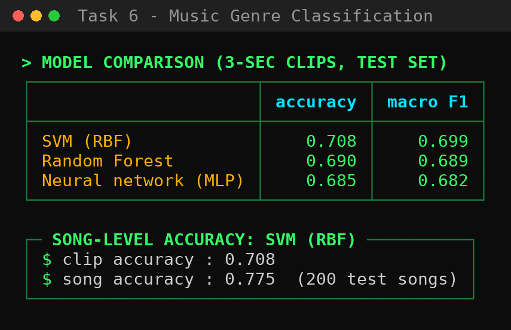

# Task 6 - Music Genre Classification

**Level 3** · Notebook: [`Task6_Music_Genre_Classification.ipynb`](Task6_Music_Genre_Classification.ipynb)

## Task brief (from the Elevvo task sheet)

**Description**
- Dataset (recommended): GTZAN (Kaggle)
- Classify songs into genres based on extracted audio features
- Preprocess features such as MFCCs or use spectrogram images
- Train and evaluate a multi-class model using tabular or image data
- If image-based, use a CNN model

**Tools & libraries:** Python · Librosa (for features) · Scikit-learn or Keras

**Covered topics:** Audio data / CNNs · Multi-class classification

**Bonus**
- Try both tabular and image-based approaches and compare results
- Use transfer learning on spectrograms

## Requirements checklist

| Requirement | Status | Where |
|-------------|--------|-------|
| Use the GTZAN dataset (Kaggle) | ✅ | Section 1 (the dataset's Librosa feature files) |
| Classify songs into genres from extracted audio features | ✅ | Sections 4-5 (10 genres) |
| Preprocess features such as MFCCs | ✅ | Sections 1 and 3 (20 MFCCs + spectral features, standardized; split by song) |
| Train and evaluate a multi-class model on tabular data | ✅ | Sections 4-6 (Random Forest, SVM, neural network; accuracy, macro F1, confusion matrix) |
| If image-based, use a CNN | n/a | The tabular approach was used, so no CNN is required |
| **Bonus:** compare tabular and image-based approaches | ❌ | Not done: training a CNN on spectrograms needs TensorFlow / PyTorch, which were not available in this environment |
| **Bonus:** transfer learning on spectrograms | ❌ | Not done, same reason |

*Extra analysis beyond the brief:* song-level majority voting (section 5), a data-leakage check (section 7), and a comparison of 3-second clips vs full 30-second songs on the same test songs (section 8).

## Dataset

1,000 songs (30 seconds each, 100 per genre: blues, classical, country, disco, hip-hop, jazz, metal, pop, reggae, rock). The dataset provides features already extracted with **Librosa**: 20 MFCCs (mean and variance), chroma, RMS energy, spectral centroid / bandwidth / rolloff, zero-crossing rate, harmonic and percussive components, and tempo, for 9,990 three-second clips (`features_3_sec.csv`) and for the 1,000 full songs (`features_30_sec.csv`).

**Split by song:** 80% of songs for training and 20% for testing (7,993 / 1,997 clips), so no song has clips in both sets.

## Results

| Model | Clip accuracy | Macro F1 |
|-------|---------------|----------|
| **SVM (RBF)** | **0.708** | **0.699** |
| Random Forest | 0.690 | 0.689 |
| Neural network (MLP) | 0.685 | 0.682 |

**Song-level accuracy (SVM, majority vote over each song's 10 clips): 0.775** on 200 unseen songs.

| Split | Accuracy |
|-------|----------|
| By song (honest) | 0.708 |
| Random clip split (leaky) | 0.913 |

| Model | 3-sec clips | 30-sec songs (same 200 test songs) |
|-------|-------------|-------------------------------------|
| SVM (RBF) | 0.708 | 0.730 |
| Neural network (MLP) | 0.685 | 0.695 |
| Random Forest | 0.690 | 0.675 |

## Conclusion

- **SVM is the best model** with 70.8% accuracy on single 3-second clips, slightly ahead of Random Forest and the neural network.
- **Voting across a song's 10 clips lifts accuracy to 77.5%**, better than any model trained on full-song features (best: 73.0%).
- **Splitting by song is essential:** a random split puts clips of the same song in both training and testing and reports a misleading 91.3%, about 20 points too high.
- **Easiest genres:** metal (F1 0.86), classical (0.85) and jazz (0.82). **Hardest:** reggae (0.54), rock (0.56) and hip-hop (0.57), which share rhythm and timbre with other genres.
- The most useful features describe **rhythm, loudness and timbre**: percussive variance, RMS energy, chroma and the first MFCCs.

## How to run

Put `features_3_sec.csv` and `features_30_sec.csv` next to the notebook and run all cells.
