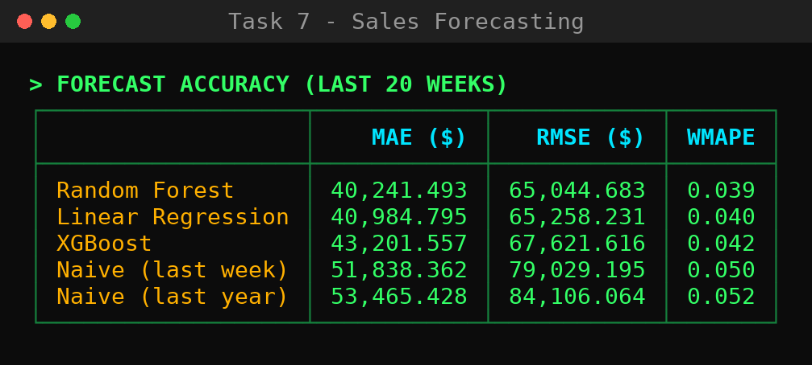

# Task 7 - Sales Forecasting

**Level 3** · Notebook: [`Task7_Sales_Forecasting.ipynb`](Task7_Sales_Forecasting.ipynb)

*WMAPE = total absolute error as a share of total sales (lower is better).*

## Task brief (from the Elevvo task sheet)

**Description**
- Dataset (recommended): Walmart Sales Forecast (Kaggle)
- Predict future sales based on historical sales data
- Create time-based features (day, month, lag values)
- Apply regression models to forecast next period's sales
- Plot actual vs. predicted values over time

**Tools & libraries:** Python · Pandas · Matplotlib · Scikit-learn

**Covered topics:** Time series forecasting · Regression

**Bonus**
- Use rolling averages and seasonal decomposition
- Apply XGBoost or LightGBM with time-aware validation

## Requirements checklist

| Requirement | Status | Where |
|-------------|--------|-------|
| Use the Walmart Sales Forecast dataset (Kaggle) | ✅ | Section 1 (`train.csv`, `features.csv`, `stores.csv`) |
| Predict future sales from historical sales | ✅ | Sections 6-7 (trained on the past, tested on the last 20 weeks) |
| Create time-based features (day, month, lag values) | ✅ | Section 5 (week of year, month, year, holiday flag, lags of 1, 2 and 52 weeks, 4-week rolling mean). The data is weekly (every row is a Friday), so day-of-week carries no information and week of year is used instead |
| Apply regression models to forecast next period's sales | ✅ | Section 7 (Linear Regression, Random Forest, XGBoost vs two naive baselines) |
| Plot actual vs. predicted values over time | ✅ | Section 9 (all stores and store 1) |
| **Bonus:** rolling averages | ✅ | Section 4 (4- and 12-week) |
| **Bonus:** seasonal decomposition | ✅ | Section 4 (`statsmodels`, 52-week period) |
| **Bonus:** XGBoost with time-aware validation | ✅ | Sections 7-8 (`TimeSeriesSplit`, 5 expanding folds) |

## Dataset

421,570 rows of weekly sales per store and department (Feb 2010 to Oct 2012), summed into **6,435 store-week rows** (45 stores x 143 weeks) and joined with temperature, fuel price, CPI, unemployment, holiday flag, store type and size. The five MarkDown columns were 64-75% empty and were dropped; nothing else was missing.

**Split by time:** trained on Feb 2011 to Jun 2012, tested on the **last 20 weeks** (Jun to Oct 2012). The first year is only used to build the 52-week lag.

## Results

| Model | MAE ($) | RMSE ($) | WMAPE |
|-------|---------|----------|-------|
| **Random Forest** | **40,241** | **65,045** | **3.9%** |
| Linear Regression | 40,985 | 65,258 | 4.0% |
| XGBoost | 43,202 | 67,622 | 4.2% |
| Naive: same as last week | 51,838 | 79,029 | 5.0% |
| Naive: same week last year | 53,465 | 84,106 | 5.2% |

**Time-aware cross-validation (5 folds):** Random Forest 5.5% WMAPE, XGBoost 5.7%. The fold covering the holiday season (Nov 2011 to Jan 2012) is the hardest, at about 10%.

## Conclusion

- **Random Forest is the most accurate model:** it forecasts next week's store sales with **3.9% WMAPE** (MAE about $40k on stores selling about $1M a week), clearly beating the naive "same as last week" (5.0%) and "same as last year" (5.2%) baselines.
- **Seasonality is strong:** Christmas week adds about **$31.8M** above a normal week for all stores combined, and late January is the weakest period. The holiday season is also the hardest period to forecast.
- **Last year's sales for the same week (60%) and the recent 4-week average (33%)** drive over 90% of the XGBoost forecast; temperature, fuel price, CPI and unemployment add very little.

## How to run

Put `train.csv`, `features.csv` and `stores.csv` next to the notebook and run all cells. In Colab, run `!pip install rich` first.
